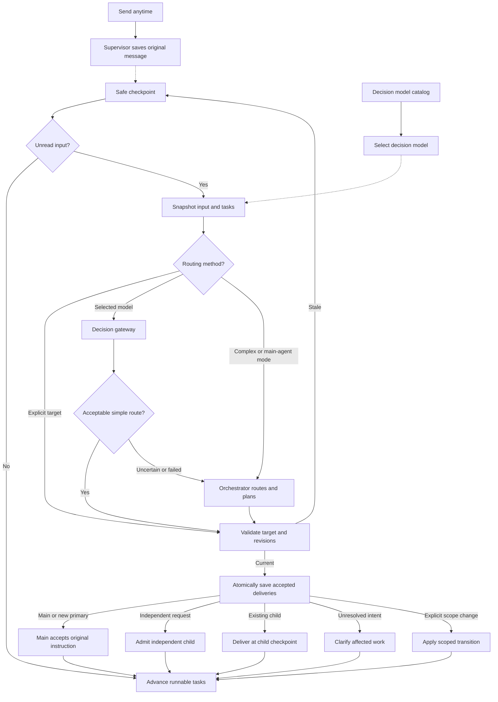
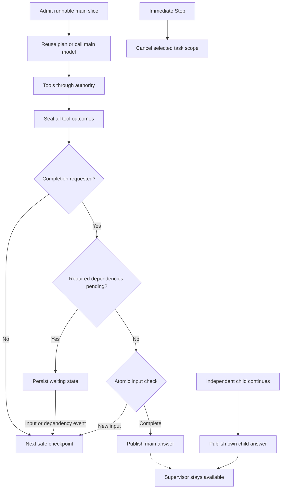

# Proposed agent-run architecture

> The decision model, the routing round, independent tasks and compound intent routing in this proposal were removed. Every sub-prompt goes to the main task, which delegates separate requests to children and answers once under the original prompt. See [Current design](./agent-run-implementation.md#current-design-one-run-one-inbox).

Design proposal updated for live user input, steering at safe boundaries, independent tasks, and a decision model selected in settings.

A session supervisor outlives any single task. It accepts messages while work is running and owns input delivery, task admission, cancellation, and resource cleanup. Each task engine owns its applied transcript and revisions. At a safe boundary, an IntentRouter uses the user's selected decision model to propose a destination for new input. The receiving task's execution model interprets the original instruction and plans its actions. The orchestrator handles compound requests, uncertainty, and explicit changes to task scope.

Decision and execution models have separate bindings. OpenRouter is the first native decision provider; its adapter supports compatible models from the live catalog. No part of the loop names Jev as a required model. Choosing a decision model works even when the main agent uses Ollama. With no decision model selected, routing remains part of the next normal orchestrator round.

The separate renderer prompt queue and its edit/reorder/drain controls leave the target architecture. Send stays available during execution and submits a normal user message. A durable input journal stores messages until a safe boundary; receipt means stored, and application means the target task has accepted the instruction. Intake does not mutate an in-flight model request.

## Input routing flowchart



The selected decision model is a conditional routing call at a safe boundary. Empty checkpoints, immediate Stop, and valid explicitly addressed normal messages skip that call. Main-agent routing mode and complex or uncertain input use the next normal orchestrator call. A fallback round that also produced a main plan supplies that same plan to the engine after durable acceptance; the engine does not request it again. With no active main task, a new request starts the primary task. While a main task is active, an independent request becomes a child.

## Execution and completion flowchart



`end_turn(status=stop)` requests completion of the current task. The engine evaluates it after tool outcomes settle, new input is routed, and required dependencies finish. Independent tasks do not join this completion barrier. A finished main task leaves the session available for child results, new primary work, and steering of existing children. Model `stop` still ends a response rather than declaring all session tasks complete. An idle wakeup advances only runnable tasks; a late independent result does not restart a completed main engine.

Dependent child batches retain their full-wave barrier. Independent child results publish their own response blocks correlated with the originating user message. A late independent result can wake an idle supervisor without reopening a completed main task. Child questions and new user input can wake a suspended parent for a control or routing round.

## Live message handling

Safe input points are a completed round after all paired tool outcomes are sealed, a completed output segment, a waiting/resume boundary, and the finalization check. They are independent of Tier 1 memory-compaction thresholds. The current provider snapshot and ordinary in-flight tool calls finish coherently. Immediate Stop uses the cancellation path.

At a boundary, the supervisor snapshots unread input through an arrival watermark, the decision settings revision, and a compact task map. The router receives original messages in arrival order. Later arrivals wait for the following boundary. The map contains objectives, constraints, task revisions, artifact ownership, dependency edges, status, and waiting questions; full child transcripts stay in child sessions. Recent relevant conversation helps resolve references such as "that report" and "make it dark."

| Interpretation | Action |
| --- | --- |
| Main-task refinement | Apply constraints to a new main revision and replan. Existing artifacts may need correction. |
| Existing-child refinement | Deliver to that child's immutable intake. Its engine applies the instruction at its own boundary. |
| Independent request | Create a scoped child linked to the source message, with an independent answer and no automatic main-completion hold. |
| Explicit replacement or cancellation | Honor the requested task scope and supersede obsolete work. Do not infer replacement merely because a request is unrelated. |
| Ambiguous intent or target | Ask a concise question and retain the unresolved message. Continue only work unaffected by that ambiguity. |

One message may contain multiple intents. The orchestrator splits a compound request into recorded intents so a report correction and a new website request can both be honored. A native Choice answer chooses one predefined option; it cannot produce arbitrary instruction text, split free text, or write a child brief. Preserve original text. Record stable intent IDs before dispatch and account for every instruction; uncovered intent remains unresolved. Apply later explicit corrections in arrival order. Do not overwrite the objective with the latest message or assume that keyword similarity determines task ownership.

Related messages in one unread batch use the orchestrator's ordered interpretation and a provisional task map. "Build a landing page" followed by "make it dark" must refer to the same planned task. Do not independently classify both messages against a map that contains no landing-page task. If input dependencies cannot be resolved with code, route the batch through one normal orchestrator round.

Routing decisions, input cursors, revision changes, and dispatch intents commit together. Actions name their task and expected revision. A tool action cannot use an obsolete report revision after that round has applied a font correction. A failed acceptance is retried from durable input. A committed dispatch ID recovers the same child instead of creating another.

For a simple independent request, the supervisor admits a child under the existing delegation policy using the intact user message as its initial request. The child develops its own plan. A child-only control boundary can finish while the main task remains suspended. A message that refers to required main-task work needs orchestration to establish that dependency.

## Decision model settings and provider support

The settings panel has a separate Decision model section with a provider selector, a searchable model selector, and a Use main agent option. Its provider/model values are independent of the main model picker. Settings show whether the selected model is compatible, unverified, or unavailable, and whether routing is automatic or assisted by the orchestrator. Changing this setting takes effect at the next safe boundary. An in-flight routing request completes under its captured configuration.

| Model role | Binding | Responsibility |
| --- | --- | --- |
| Main execution | Existing main provider/model selection, captured for task execution | Understand the task, plan, use tools, and produce the main answer |
| Decision routing | New independent settings selection, captured at each routing boundary | Choose a permitted destination for new input |
| Child execution | Existing delegation policy and each child's task binding | Plan and execute that child's request in its own context |

Persist `decisionRouting` as `UseOrchestrator` or `UseModel(providerId, modelId)`, with a monotonically increasing settings revision. Derive the protocol and supported decision operations from provider capabilities; do not expose protocol internals as user settings. Reuse the provider's credential configuration inside the gateway. Persist no API key in routing records, task transcripts, or UI model settings.

For OpenRouter, load the native decision catalog with `GET /api/v1/models?output_modalities=decisions`. Preserve input/output modalities, model IDs, aliases, context limits, pricing, and capability evidence. Use a cache keyed by provider and model role. Current Xekute discovery uses the globally active main provider and drops modalities; the proposed discovery API takes the provider and role explicitly. Decision entries can have an empty `supported_parameters` array, so a chat-tools or structured-output filter would discard usable native models. [Catalog API](https://openrouter.ai/docs/api/api-reference/models/list-all-models-and-their-properties), [live decision catalog](https://openrouter.ai/api/v1/models?output_modalities=decisions).

The OpenRouter decision adapter uses `POST /api/alpha/decisions` with `model`, `state`, and typed `questions`. It decodes the response into Xekute's routing result. Resolve this endpoint independently of the existing `/api/v1` chat base URL. It has a separate request identity, abort signal, deadline, and usage accounting. [OpenRouter decision request examples](https://openrouter.ai/blog/insights/what-is-jev/).

Decision output modality is discovery evidence, not proof that a model supports this router. Verify finite Choice support, input types, option/question limits, and effective context limits using provider evidence or a bounded compatibility check. Keep unsupported and unknown states explicit. A model that only scores behaviors does not satisfy a Choice-based routing contract. New model families use the same provider operation when compatible; adding a provider means adding its adapter rather than branches in the turn engine.

A structured-chat routing adapter may be added for other compatible providers. It returns the same domain result, validates its JSON at the gateway, and does not invent native probabilities from a model's written confidence. The native decision picker does not need to include all ordinary chat models.

## Routing contract and fallback

```text
DecisionSelection = UseOrchestrator | UseModel(providerId, modelId)
BoundarySnapshot = originalMessages + arrivalWatermark + compactTaskMap
                 + taskRevisions + cancellationEpoch + settingsRevision
Route = Deliver(taskId) | StartPrimary | StartIndependent
RoutingResult = ProposedRoutes(routes, snapshotId, provenance)
              | NeedsOrchestrator(reason, advisoryEvidence?)

modelCatalog.list({ providerId, role: decision }) -> model capability records
settings.setDecisionSelection(selection) -> settingsRevision
intentRouter.route(boundarySnapshot) -> RoutingResult
sessions.acceptInputProposal(proposal) -> Accepted | Stale | Cancelled
```

This is a domain sketch, not a provider wire schema. A native route option combines action and destination, such as `deliver:T1`, `deliver:T2`, `start-independent`, or `needs-orchestrator`. That prevents an independently predicted action and target from contradicting each other. Explicit replacement, cancellation inferred from text, compound intent, and ambiguous ownership go to the orchestrator. Immediate Stop remains a direct scoped control.

The router builds minimal state from the intact message, current objectives and constraints, recent relevant messages, and task summaries. It never executes tools, rewrites the instruction, generates a brief, or grants new permissions. The task receives original text and relevant task context. Main steering still needs a normal generative planning round even when the route is already known.

Before accepting an automatic route, code validates the response shape, allowed option, target status, relevant task revisions, cancellation epoch, model capabilities, and evidence policy. Exceeded option/context limits use fallback rather than dropping messages or silently excluding plausible targets. Arrivals after the captured watermark remain unread and do not invalidate the earlier batch by themselves. A stale task snapshot returns to a fresh boundary with a bounded retry allowance.

Confidence is evidence about a distribution, not a guarantee of correctness. Track an evidence policy for the resolved model version, route contract, and intended domain. Calibrate automatic-route thresholds on representative routing examples; do not assume one cutoff transfers across every model. [Choice contract](https://docs.typesafe.ai/primitives/choice), [confidence interpretation](https://docs.typesafe.ai/confidence).

A compatible but uncalibrated selection has a visible advisory status. Its validated hint can assist the next normal orchestrator round alongside the original messages, without silently authorizing dispatch or discarding a paid response. Settings expose the compatibility check and calibration status. Verified profiles can permit automatic simple routes. Unknown capability skips the native call until compatibility is established. Switching an alias to a new resolved version refreshes the capability/evidence profile while preserving the user's selection.

Use one bounded native request per eligible boundary batch. Missing probability evidence, low confidence, invalid output, an unavailable model, a timeout, or unsupported input returns `NeedsOrchestrator`. Do not repeatedly repair the classifier or cascade through other models. Repeated provider failures can put this routing role into a visible cooldown; ordinary orchestrator routing continues. The fallback uses the next normal planning round once, with full original messages and any valid advisory evidence.

Acceptance persists routing provenance, original-message deliveries, stable intent/dispatch IDs, cursor updates, and any supplied main plan under one durable contract. A retained main plan names its delivery ID and expected task revision. Recovery must not consume input before that plan or delivery is recoverable. Reuse committed routes on resume; do not reclassify the same accepted input with a newly selected model. External side effects still require the existing tool reconciliation rules.

## Proposed module boundaries

| Module | Contract |
| --- | --- |
| Settings and model catalog | Persist independent model roles; discover models for an explicit provider/role; maintain compatibility/evidence profiles |
| `src/agent/runtime/intent-router.js`, proposed | Build bounded routing choices and compact state; apply explicit-target rules and evidence gates; return domain proposals or one orchestrator fallback |
| Model gateway and `src/agent/llm/openrouter/decisions.js`, proposed | Own native protocol details, private credentials, cancellation, deadlines, response parsing, and usage |
| Session supervisor/storage | Create boundary snapshots; atomically accept routes/deliveries/plans; own admission, dispatch, and conditional finalization |
| Existing task engines | Interpret accepted original messages; revise objectives/constraints; reuse a supplied plan or request the next execution round |

Keep the router independent of provider wire formats and task history mutation. Keep fallback scheduling at the supervisor/engine boundary, where task admission is already owned. A generic event bus, a classifier-specific task engine, and per-model hardcoded adapters are unnecessary.

## Report example

1. "Write me a detailed report" starts main task T1.
2. "Make sure the report uses Arial" is received while T1 runs. At its next safe boundary, the selected decision model proposes delivery to T1. T1's execution model updates its constraints, acknowledges the change, and revises the report if required.
3. "Also build a landing page" can receive a validated independent-task route and create T2 from the original request. T1 continues its report while T2 plans and works in a separate child context.
4. "Use a dark theme for the landing page" targets T2 and reaches its next child boundary. T1's report objective stays intact.
5. T1 can publish its answer while T2 is still working. T2 later publishes its own answer against the landing-page request.
6. "Use Arial and build a landing page" takes the orchestrator path to record both intents. An uncertain or unavailable decision model takes this same fallback path.

## Ownership

| Owner | Responsibilities |
| --- | --- |
| Session supervisor | Submit/cancel API; session lifetime; writable immutable intake; parent admission; task registry and routing records; stable task identities; scoped resource lifetime and cleanup |
| Session/task storage | Input journal and arrival watermark; original message IDs; routing decisions; per-task transcript, revision, applied cursor, completion intent, pending operations, and accounting; atomic commit contract |
| IntentRouter | Finite routing choices; compact semantic input; explicit target handling; model compatibility and evidence gates; domain routing proposals and fallback reasons |
| Settings and model catalog | Independent execution/decision bindings; versioned settings snapshots; provider/role discovery and capability/evidence profiles |
| Turn engine | Safe input boundaries; immutable round snapshot; original-message interpretation; supplied-plan reuse; dependency-aware completion; continuation, repair, and no-progress accounting |
| Context manager | Provider-history projection, paired tool messages, token budget, Tier 1 summaries, cached immutable prompt/tool material, revision-based invalidation |
| Model gateway | Explicit provider/model binding; Ollama/OpenRouter chat and native decision operations; private credentials; request deadlines, bounded attempts, abort-aware backoff, normalized domain outcomes |
| Tool runner | Parsing, one outcome per identifiable call, authority pipeline integration, resource reservations, ordered outcome slots, reconciliation of interrupted effects |
| Existing child coordinator and process manager | Separate task lifetimes, bounded worker admission, dependency-aware waves, steering delivery, per-task outcomes, questions, and scoped cancellation |

## Caller interface sketch

```text
sessions.submit({ sessionId, messageId, text, targetTaskId? }) -> durable receipt
sessions.cancel({ sessionId, taskId, scope, reason }) -> acknowledgement

receipt = { messageId, arrivalSequence, status: received }
task outcome = Completed | Suspended | Cancelled | Failed
```

Electron main adapts IPC and publishes UI events. Sending while busy appends input without requesting another simultaneous parent turn or cancelling the existing one. The supervisor internally admits the next safe execution slice. UI shows the user message immediately, then distinguishes receipt, application, clarification, child admission, and the task's answer. Send and Stop are separate controls.

## Rules the design must enforce

- Each task engine is the sole writer of its applied transcript and revision. Intake only appends immutable messages. The supervisor owns parent routing/task metadata; child status is a projection of the child's durable state. Provider history and summaries are projections rather than competing authoritative histories.
- A model reply and its ordered tool identities are recorded before side effects begin. Every recognizable call receives an outcome, including malformed arguments and policy denial. An unusable envelope gets explicit, bounded protocol-repair feedback.
- Receipt, input application, and dispatch are idempotent under stable message/intent/operation IDs. A result or steering delivery is acknowledged only after durable acceptance. A later failed model call does not erase it. Keep unresolved clarification visible instead of marking it applied.
- Decision settings are separate from execution settings. Each boundary captures its selection and evidence-policy version. Requests have role-specific cancellation identities. A configuration edit alone does not invalidate accepted task work or an in-flight routing snapshot.
- Provider output is parsed and validated at the gateway. A routing choice is permitted only for an allowed action/target under current task state and evidence policy. Model confidence, model selection, and original task wording cannot bypass the authority pipeline.
- A fallback orchestrator round may route and plan together. Persist any returned plan with its stable delivery identity and revision before acknowledging input. Reuse it once after acceptance; do not add a second planning call for the same boundary.
- Resume preserves the task run ID and latest accepted objective revision. Explicit replacement records the predecessor/successor transition rather than accidentally assigning a new identity to ordinary steering. Pending commands reconnect by handle. Uncertain mutations require reconciliation before any replay; a write-ahead record alone cannot guarantee exactly-once shell or filesystem effects.
- Model attempts, output segments, protocol repairs, and no-progress streaks have separate counters. No output continuation refunds another counter. Total job duration can remain unlimited.
- Waiting performs no model polling. New user input or a relevant child/command event can wake the supervisor. Main completion releases main-owned resources; independent children retain their own controllers and delivery lifetime. Explicit Stop cancels its selected task scope and owned descendants.
- Independent children are session-managed tasks rather than completion dependencies owned by the main task. Their result delivery survives main completion. Cancelling the whole session remains an explicit broader scope.
- A clarification that may change the main result is a completion dependency. Preserve its source message, pause affected actions, and permit unaffected work while waiting for the answer.
- Tool concurrency depends on declared independence or resource reservations. Unknown mutation tools retain order. Results enter provider history in model-call order even when execution completes in another order.
- Independently requested work can still conflict over files or other resources. Give each child scoped artifact ownership or reserve conflicting resources. Worker-capacity limits produce an honest waiting-for-capacity state; receipt must not imply a child has started.
- One supervisor cleanup scope starts with the first resource acquisition and runs on setup failures, suspension, completion, and cancellation. Parent admission remains held through required final writes.
- Intake append, routing acceptance, and conditional finalization use one storage serialization contract with short atomic writes. No lock or storage transaction spans a model or tool await. Finalization compares the current durable arrival watermark to the routed watermark and commits terminal state conditionally. Pre-commit arrivals force another boundary; post-commit arrivals remain accepted for new primary work or an existing child.
- A completed effect remains part of the record after steering. A font correction can trigger an artifact edit; reversing an already-completed external effect requires an explicit subsequent action. Receipt alone does not reset a no-progress streak.
- Atomic replacement of separate files is insufficient for cross-record acceptance/finalization guarantees. Persistence failure must not report durable success or acknowledge uncommitted input.

## Expected efficiency changes

The design can remove repeated requests with no feedback and avoid waiting for an entire main task before applying user input. A selected native decision model adds a conditional call. Empty or explicitly targeted input skips it; complex input and fallback share the next normal orchestrator round. Independent and existing-child routes can finish at a control boundary without forcing the main task to replan while suspended. Main refinements still require execution-model planning.

Independent tasks can overlap main work under the worker/resource limits. Cache static prompts, tool definitions, catalog capabilities, and role profiles. Invalidate context on transcript, memory, catalog, budget, and task revision changes. Durable accepted-route reuse avoids duplicate classification during recovery; text alone is not a valid cache key for semantic routing. Measure receipt-to-application latency, router latency/cost, automatic-route and fallback rates, routing mistakes, provider/tool/context timings, retries, tokens, and duplicate dispatches. Exact benefits require measurements.

## Synthesis decision

Re-evaluated both structural candidates with live input as a foundational requirement. Use the supervisor and focused engine with immutable intake as the base. Adopt the actor candidate's explicit revision-checked dispatch and a session lifetime independent of the main task. Keep typed states and atomic message/route transactions without introducing a general reducer/effect-dispatch framework.

The new requirement supersedes the earlier universal child-completion hold. Full-wave barriers apply to dependent delegated work; independently requested tasks run alongside the main task and do not prevent its answer. The alternatives converge on durable staging, next-round routing, isolated child state, and a conditional finalization watermark.

For configurable decision models, use the dedicated IntentRouter candidate as the base. The review scored it 22/25 and a unified TurnPlanner 20/25. These are design judgments, not runtime measurements. IntentRouter keeps session routing separate from task planning with a smaller caller contract. Adopt the unified candidate's bounded inference sequencing, explicit compound-intent coverage, and visible capability/calibration profiles. Use one durable delivery contract to close the separate route/plan acceptance gap. A unified planner with public control-versus-execution flags adds ownership rules that this change does not require.

## Rationale evidence and gaps

- Source control: `e79dbafd3a42df64f2a9c2aac2eab81e9b72dadd` explicitly introduced unlimited budgets for multi-day jobs. `d0140fef52b4656a8acad037b317ea2a6ffdf6a5` explicitly requires batch child waiting and parent-scoped Stop. Current tunables and coordinator tests retain these contracts.
- Issue tracker: GitHub searches for `repo:mahirhacks/XEKUTE is:issue agent` and `repo:mahirhacks/XEKUTE is:issue loop` returned no issues.
- Long-form documents: no matching project document connector was available; local architecture documents were part of the source trace and include stale paths.
- Team chat, infrastructure observability, exception tracking, and product analytics: no matching connectors were available.

The historical record supports long jobs and explicit completion. The user requirements establish safe-boundary steering, independent parallel tasks, and a decision model selected in settings. Official OpenRouter catalog/protocol sources above establish native decision-provider support. Durable acceptance, caching, no-progress definitions, deadlines, and backoff remain proposed improvements. Storage atomicity, routing-profile calibration, and tool-specific reconciliation remain implementation questions.

## First implementation slice

Implement durable input receipt and safe-boundary consumption in the existing long-lived controller, including paired errors and an atomic finalization check. Add separate decision settings, provider/role catalog discovery with preserved modalities, and the native Decisions gateway operation. Connect IntentRouter with normal orchestration fallback, structured task revisions, durable plan delivery, and dependency-aware child admission. Migrate existing pending renderer prompts once into the input journal before deleting queue state, controls, imports, and whole-turn drain logic. Existing child steering at one-round boundaries is a source pattern, not a substitute for durable parent intake.

This document updates the target architecture. It does not implement the proposed agent-loop, settings, or queue changes.

## Current source anchors

- `src/app/electron/main.js:3200`: outer lifecycle and continuation admission.
- `src/app/electron/main.js:3476`: controller registration before narrower cleanup.
- `src/agent/controller/agent-controller.js:527`: current inner loop.
- `src/agent/controller/agent-controller.js:1387`: malformed-call branch.
- `src/agent/controller/agent-controller.js:1726`: pending-work completion handling.
- `src/agent/runtime/tunables.js:3`: explicit long-job rationale.
- `test/subagent-coordinator.test.js:52`: parent stays quiet until the wave is terminal.
- `test/subagent-coordinator.test.js:303`: parent-scoped Stop.
- `src/ui/features/chat/prompt-queue.js`: current renderer prompt storage.
- `src/ui/bootstrap.js:20655`: queue waits for the running session before dispatching another turn.
- `src/ui/bootstrap.js:20683`: input sends while busy enter the current prompt queue.
- `src/agent/runtime/delegation-provider.js:507`: existing child steering between single-round runs.
- `src/app/electron/main.js:749`: current global provider selection and role-independent connection preferences.
- `src/app/electron/main.js:779`: current settings persistence, with no decision binding.
- `src/app/electron/main.js:2087`: OpenRouter catalog projection currently drops output modalities.
- `src/app/electron/main.js:2305`: existing JSON operation uses chat transport.
- `src/app/electron/main.js:2346`: current model discovery depends on the active main provider.
- `src/app/electron/main.js:2758`: current execution round resolves the global provider.
- `src/app/ipc/project.js:1013`: live LLM settings handlers.
- `src/ui/bootstrap.js:4335`: existing settings load and main-model selection flow.
